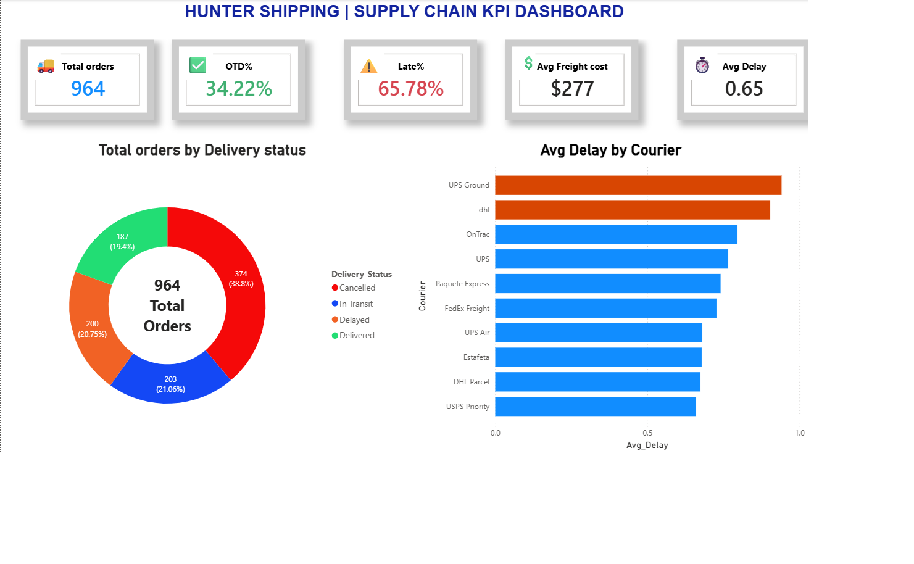

# 🚚 Hunter Shipping KPI Dashboard

Executive logistics dashboard to track On-Time Delivery, late shipments & carrier performance.

**Author:** Gloris Paulraj | Supply Chain Analyst | Hamilton, ON
**Project Type:** Python (Generation + Cleaning) + Power BI | No SQL
**Live Repo:** `glorisprema/Hunter-Shipping-KPI-Dashboard`

### 📸 Dashboard Preview

**HUNTER SHIPPING | SUPPLY CHAIN KPI DASHBOARD**

- **964** Total Orders (Cleaned from 1025)
- **34.22%** On-Time | **65.78%** Late
- **$277** Avg Shipping Cost | **$267K** Total Cost
- **38.8%** Cancelled Rate - Key Problem Found

### 🔧 Tech Stack

- **Python:** Pandas, NumPy
- **Power BI:** DAX, Power Query, KPI Cards
- **Concepts:** Data Generation, Data Cleaning, Supply Chain KPIs

### 📂 Project Flow - End to End

#### Phase 1: Data Generation (Hunter project.ipynb)

Generated synthetic logistics data to simulate real WMS issues.

- `seed 101, n=1025` → `hunter_final_all_couriers.csv (1025, 13)`
- Injected Mess: 
    - Dates: `2023-01-15` vs `15/02/2023` vs `2023/03/10` vs invalid `2023-13-40`
    - Cost: `'$250'`, `'USD 450'`, `'$-50'`, `'$'`
    - Quantity: `-5`, `9999`, `None`
    - Category: `Soap`, `soap`, `SOAP`
    - State: `California`, `CA`, `Texas`, `NY`
    - Delay: `100` outlier, `None`
    - Added **70 duplicates**

#### Phase 2: Data Cleaning (1025 → 964)

Cleaned in same notebook → `hunter_cleaned.csv (964, 13)`

- **Date:** `pd.to_datetime(errors='coerce', dayfirst=True)` - dropped invalid `2023-13-40`
- **Cost:** Stripped `$` and `USD`, converted to numeric, removed `$-50` and `$`
- **Quantity:** Removed `-5` and `9999` outlier
- **Category:** `.str.lower().str.title()` → `Soap`
- **State:** Mapped `CA→CALIFORNIA, NY→NEWYORK` + `.str.upper()`
- **Courier:** `.str.strip()` fixed spaces
- **Delay:** Removed `100` outlier
- **Duplicates:** `drop_duplicates()` - removed 70

**Final Cleaned (964):**
- Origin: Dallas TX 326 (Top) | Miami FL 165 | Los Angeles CA 163
- Delivery: Cancelled 374 (38.8%) | In Transit 203 | Delayed 200 | Delivered 187

#### Phase 3: Power BI Dashboard

**File:** `Hunter power BI project.pbix`

- No SQL - Direct CSV import
- **DAX Measures:** `Total Orders = COUNTROWS(hunter)` (964), `Avg Cost = AVERAGE()`, `Total Cost = SUM()`
- **Visuals:** 5 KPI Cards, Donut (Delivery Status), Bar (Avg Delay by Courier)

### 📁 Files in This Repo

- `Hunter project.ipynb` - Full code: Generation + Cleaning
- `hunter_final_all_couriers.csv` - Raw 1025 rows (messy)
- `hunter_cleaned.csv` - Cleaned 964 rows
- `Hunter power BI project.pbix` - Power BI Dashboard
- `Hunter_Dashboard.png` - Dashboard Preview

### 💡 Key Insights Found

- **38.8% Cancellation Rate** - Main supply chain problem
- **Dallas TX** is top shipping origin (326)
- **TEXAS** is top destination state
- Mexico 486 vs USA 478 shipments

### ▶️ How to Run

1. Open `Hunter project.ipynb` in Jupyter
2. Run cells - generates 1025 → cleans to 964
3. Open `Hunter power BI project.pbix` in Power BI Desktop
4. Refresh with `hunter_cleaned.csv`

---
**Gloris Paulraj | Hamilton, ON**
LinkedIn: https://www.linkedin.com/in/gloris-paulraj-9302009b/
